# ORBIT Product Requirements Document

**Version:** 1.0  
**Status:** Planning complete; implementation must begin with the approved foundation milestone  
**Product owner and developer:** User (solo developer)  
**Implementation and review support:** Anti Gravity 3.8 Flash for coding; ChatGPT/Codex for planning, prompt preparation, architecture review, and verification

## Executive summary

ORBIT is an original Windows 11 desktop companion that presents glanceable system and productivity information in a floating Dynamic Island-style interface. It combines an unobtrusive compact island with expandable panels for media, calendar and agenda, timers, hardware status, notifications, and a file shelf. The visual direction draws on Apple Dynamic Island, vivo/Origin Island, Windows desktop mods, and the supplied ORBIT logo and screenshots; ORBIT must be implemented from scratch and must not copy reference projects' code.

The product is local-first, privacy-conscious, modular, and lightweight. The first delivery sequence is a working foundation followed by the first functional core shell. Feature integrations are added incrementally and must report real supported data; mock data must be clearly labeled. The normal-use memory goal is below 50 MB, with 100 MB as the maximum, while keeping CPU use low enough for an 8 GB Windows 11 laptop.

This document consolidates the confirmed planning decisions and supplied visual references. Windows API behavior and the performance targets remain subject to prototype measurement. Material product decisions recorded here include the four-section navigation behavior and Home activity priority.

## 1. Product goals and principles

### Goals

- Build a polished and customizable Windows 11 overlay with a compact default state and useful expanded states.
- Combine live system information, media controls, notifications, file shelf, calendar, and productivity information in one interface.
- Remain responsive and lightweight while idle and active.
- Use native Windows integrations where practical, with honest unavailable states when APIs or permissions do not support a feature.
- Work offline for local features and avoid requiring an ORBIT-owned backend for the initial version.
- Support incremental implementation and verification by a solo developer using Anti Gravity and ChatGPT/Codex assistance.

### Product principles

1. Local-first and privacy-conscious. No telemetry, analytics, or uploads by default.
2. Lightweight while idle. Pause or slow unnecessary polling and animation when content is hidden.
3. Graceful failures. A permission denial or unsupported integration must not destabilize the shell.
4. Honest data. Never present mock, stale, or unsupported data as live information.
5. Safe file handling. Preserve original user files and require explicit intent for managed copies or deletion.
6. Incremental delivery. Complete acceptance criteria for each milestone before moving on unless the user explicitly approves documented limitations.

## 2. Users and primary scenarios

The primary user is a Windows 11 user who wants quick, glanceable information and controls without opening full applications. ORBIT is also designed for a solo developer to build in verified slices.

- Glance at the time, date, optional weather, and active status.
- Control an existing Windows media session without ORBIT playing media itself.
- See a compact agenda and local reminders.
- Start and follow a timer while continuing to use another application.
- Inspect selected CPU, memory, GPU, network, and disk indicators.
- Temporarily hold file references, copy selected files into ORBIT-managed storage, or share/open files.
- Review notifications and privacy indicators without exposing content when Privacy Mode is enabled.

## 3. Visual identity and supplied references

The selected primary logo uses a central pill, orbital rings, cyan/violet/magenta/orange light accents, a dark navy ground, and ORBIT typography. The logo is included with this PRD. Required production variants include taskbar/tray, installer, small-size simplified, and light/dark-background variants.

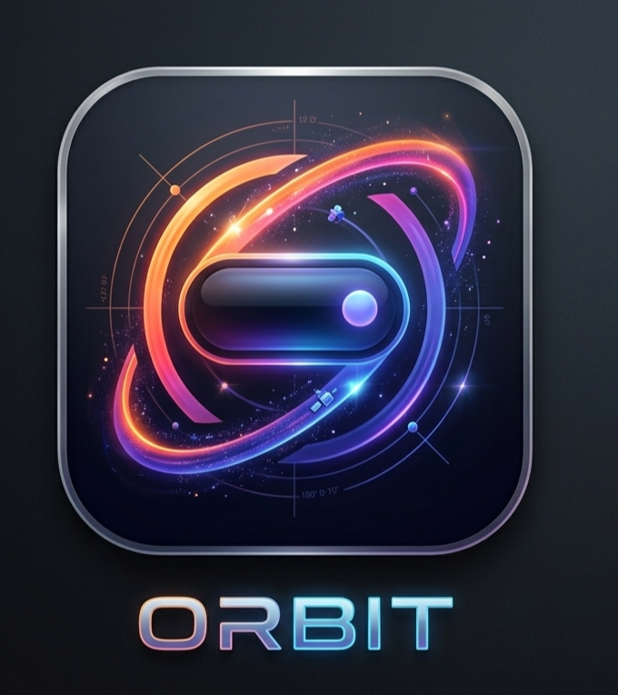

The UI references are supplied as design direction, not pixel-perfect implementation mandates. ORBIT floats over the desktop and is not attached to a physical display notch. Top-center is the default position, with top-left and top-right options. Keep moderate spacing from the top edge.

| Reference | What it informs |
|---|---|
| Idle clock and date | Expanded Home hierarchy and dark translucent panel |
| Mini time and weather capsule | Compact glance state |
| Timer and media islands | Concurrent activity layout and distinct timer/media presence |
| Hardware monitor | Two-column metric cards and restrained cyan indicators |
| Context menu | Hide/dismiss, timer focus, pin expanded, game overlay, style, expand behavior, transparency, theme, and Settings actions |
| Calendar panel | Month view, selected day, clear date hierarchy |
| Notification toast | Compact notification with app identity, message, and progress/expiry treatment |
| Microphone privacy pill | Visible system privacy state and app attribution when Windows exposes it |
| File shelf screenshot | App shortcuts and a browsable media/file surface as interaction inspiration |

### Appearance and animation

- Theme presets discussed: Obsidian, Espresso, Evergreen, Node, and Custom Colors. The final preset count may change.
- Follow Windows appearance is the default; support light, dark, and follow-Windows modes.
- Theme palette and glass appearance are separate controls.
- Glass options: Frosted Glass (subtle translucency/blur), Glossy Glass (reflective highlights), and Smoked Glass (darker/less transparent). Validate blur/translucency on supported Windows configurations.
- Support custom accent/palette configuration and optional adaptive accents based on current album artwork.
- Provide sensible size presets and configurable corner styles. Expanded content uses a rounded rectangle and fixed dimensions by default, reflowing content within the panel. Modest resizing may be added where needed.
- Default animation is Smooth Stretch: horizontal expansion followed by vertical growth with a subtle spring finish. Spring Expansion is an alternate. Respect reduced-motion settings with materially reduced movement.

## 4. Product structure and interactions

### Windows and states

- One transparent main island window transitions between compact and expanded states.
- One separate Settings window.
- Avoid unnecessary window recreation, flicker, duplicate listeners, and state loss during transitions.
- Compact state shows clock/time and optional weather, or active feature content when an activity takes priority.
- Context menu is available from the island; Settings is also accessible from the system tray.
- The shell should be shown as soon as practical at startup. Integrations initialize in the background.

### Home activity priority — confirmed

When Music or another activity is active, the large Home clock/date does not appear. The active activity takes its place. Music information and controls receive priority when media is active. The idle Home state shows the large clock/date, with microphone/camera status near the bottom when available.

### Expanded panel sections — confirmed order

The four sections are Home, Calendar, Productivity Hub, and Hardware Monitor. Navigation uses mouse wheel or touchpad scrolling within the expanded island. Scrolling starts at Home and proceeds through the sections to Hardware Monitor, where it stops. The user must scroll upward to move back; navigation does not wrap around. Four vertically stacked dots at the right edge indicate the current section; dots are indicators, not navigation buttons. Prevent accidental background scrolling and skipped sections.

### Simultaneous activities

- Music and a timer may appear as separate adjacent islands.
- Notifications temporarily replace the music island visually; the timer remains visible and playback continues.
- After a short configurable display period, music reappears.
- Queue or group notifications when needed. Do not create a third island solely for notifications.
- Media start may briefly expand the island for approximately 1–2 seconds, then return it to compact mode.
- Collapsing ORBIT never stops playback.

## 5. Functional requirements

### 5.1 Idle state, clock, and weather

- Show clock and date in idle Home.
- Support 12-hour and 24-hour formats, including AM/PM for 12-hour mode.
- Weather and temperature are optional and configurable.
- Compact by default; grow only when active content requires it.
- Compact media may show album art or app icon, title/artist when space permits, and a subtle waveform/equalizer. Compact mode has no playback controls.

### 5.2 Universal media controls

Support compatible Windows media sessions where available, including local players, Spotify, YouTube Music, and browser media from Edge, Brave, Chrome, and other apps exposing Windows media sessions.

- Auto-detect active media by default; allow manual selection or pinning.
- Newly playing source takes priority unless pinned. When it stops, return to a previously playing source if still active.
- Expanded music shows album art, title/artist, progress and seek control, elapsed/total time, and supported previous/play-pause/next controls.
- Show output-device name/picker only if reliable Windows support is validated.
- Show only controls actually exposed by the current session.
- ORBIT controls existing sessions; it does not play media itself in the initial release.

### 5.3 Timers and reminders

- Compact timer shows name, remaining time, and circular progress.
- Support start, pause, resume, reset, and timer naming/focus behavior.
- Timer deadlines persist across sleep and application restarts; calculate remaining time from deadline rather than assuming uninterrupted process uptime.
- Local reminders work without accounts.
- Prioritize important timer alerts in the notification queue.
- Dedicated Pomodoro feature is not confirmed and is excluded unless later approved.

### 5.4 Camera and microphone privacy indicators

- Show clear, accessible indicators when Windows exposes reliable status.
- In expanded Home, identify the using application when attribution is genuinely available.
- Never imply system-wide visibility when Windows provides only partial information.

### 5.5 Calendar and Productivity Hub

The panel includes a calendar section and a compact Productivity Hub agenda. The agenda replaces the rejected design with separate Notes, To-do Manager, Daily Tasks, and Events pages. Show approximately 3–4 upcoming tasks, events, reminders, or deadlines.

Planned sources: local reminders, Google Calendar, and Microsoft Outlook/Microsoft Graph. The exact local Windows calendar source must be defined and validated; a local Windows calendar is not automatically equivalent to an Outlook/Graph account. Account integrations use direct OAuth with least-privilege permissions, secure token storage, and clear reconnect/disconnect behavior. Google Cloud project/API setup or Microsoft Graph delegated permissions may be required. No ORBIT-owned backend is planned initially.

### 5.6 Hardware and system monitor

Planned values: CPU use, RAM use, GPU metrics where supported, network upload/download speeds, disk space/use, charger/power changes, Wi-Fi/network changes, and device connect/disconnect events. Refresh approximately once per second while the panel is visible; slow or pause unnecessary polling while hidden. Unsupported metrics must be shown as unavailable, never fabricated. Brightness control, output-device switching, GPU metrics, and some device events depend on hardware, drivers, and Windows APIs and need validation.

### 5.7 Notifications

- Compact notification includes app identity and a short message; expanded hover preview shows full available content and supported actions.
- Clicking the body invokes the original/default activation behavior.
- Show only actions actually exposed by Windows.
- Group repeated notifications from the same application; bound the queue, summarize overflow, and expire stale ordinary notifications.
- Never silently discard critical timer alerts.
- Respect global and per-app settings, privacy mode, preview privacy, priority, and display duration.
- Handle duplicates, missing icons/metadata, and stale activation safely.
- Do not scrape Windows notification databases.
- During fullscreen suppression, queue ordinary notifications and do not force the full panel over content.

### 5.8 File Shelf and sharing

The default shelf stores references to files rather than copying originals. Optional managed copies require explicit user choice.

- Maximum 10 held shelf items. Direct drag-and-drop transfers remain unlimited.
- When full, reject additional held items with a clear message; never silently replace an item.
- Removing a reference never deletes the original. Deleting a managed copy requires explicit action.
- Do not scan automatically for missing files; handle unavailable files when opened.
- Prevent duplicates using reliable file identity or normalized paths where practical, not filename alone.
- Support multi-select and Share, Copy, Open, Drag Out, and Remove.
- Dragging onto ORBIT opens a temporary drop target and lets the user choose hold-reference or copy-to-managed-storage.
- Dragging out passes the original file where possible without moving/deleting it. Use native Windows Share where supported; otherwise offer Open, Copy, or Copy Path.
- Use temporary files for managed copies. Do not mark partial copies complete; clean up or quarantine interrupted copies safely, preserve originals, and offer retry.
- Do not load full files into memory merely to manage the shelf; generate previews on demand.

### 5.9 System utility events

Surface supported charger/power, Wi-Fi/network, and device connect/disconnect events. Exact signals depend on Windows APIs and must be validated.

## 6. Settings, onboarding, privacy, and data

### Settings areas

Appearance and themes; animation and reduced motion; position and size; content density; startup behavior; notifications and privacy; integrations and connected accounts; File Shelf; reset controls; About and diagnostics. Suggested density presets are Compact, Balanced, and Detailed, with Balanced recommended; confirm labels during Settings design.

### Onboarding and startup

- Brief first-launch introduction and skippable guided tour; revisit from Settings or tray.
- Normal restarts do not replay onboarding. Explicit full reset may replay it.
- Request permissions at point of use, explain why, and allow deferral or denial.
- Launch at Windows sign-in when enabled.
- Show the basic shell as soon as practical; initialize calendar, media, and other integrations in the background. Do not wait for remote metadata before showing the island.

### Privacy and data management

A central Privacy & Permissions page shows access status, connected accounts, data-handling explanations, and disconnect controls. Provide three reset levels: reset settings; clear local data; full reset to initial onboarding. Explain effects on reminders, accounts, caches, managed copies, and preferences. Never delete original user files during ORBIT reset.

No telemetry, analytics, or uploads by default. Privacy Mode uses app name and a generic label instead of notification content. Local diagnostics must not contain tokens, message contents, file contents, or unnecessary personal data.

### Storage decisions

| Data | Storage |
|---|---|
| Themes, preferences, layout, simple configuration | JSON |
| Structured reminders, shelf metadata, and justified structured records | SQLite |
| Authentication tokens and secrets | Secure OS-backed storage |
| File contents | Not copied by default; optional managed copies only by explicit user action |

Exact schema, migration approach, and secure-storage implementation are implementation-planning details. Keep all user data local by default.

## 7. Architecture

| Layer | Decision |
|---|---|
| Desktop framework | Tauri 2 |
| Front end | React + TypeScript, Vite, CSS/Tailwind |
| Animation | Motion for React |
| State | Zustand |
| Validation | Zod and backend validation at command/persistence boundaries |
| Backend | Rust |
| Windows integrations | Layered modules behind defined interfaces |
| Windows | Transparent island window plus separate Settings window |
| Persistence | JSON + SQLite + OS-backed secret store |
| Backend service | No ORBIT-owned server for initial version |

The UI communicates with Rust through typed commands and events. Isolate Windows APIs behind small Rust interfaces. Planned modules include media sessions, notifications, hardware/system monitoring, calendar providers, file operations, timers/reminders, local persistence, startup, and window lifecycle. Feature failures remain independent. Separate native helper processes are not the default; add one only to solve a demonstrated limitation. Avoid duplicate timers, subscriptions, listeners, or polling.

## 8. Reliability and failure behavior

- Local features continue offline; use safe cached data where appropriate.
- Retry transient failures with backoff, recover silently when safe, and show clear nonintrusive messages when user action is needed.
- Handle sleep/wake and display changes. Rediscover media sessions and hardware after recovery.
- Attempt safe crash recovery with retry limits and manual-launch fallback; avoid crash loops.
- Restore safe UI state, timers, and reminders; never treat stale data as current.
- Fullscreen suppression: hide ORBIT during games, exclusive/borderless fullscreen, and reliably detectable fullscreen browser video. Timers continue; media and notification state update in background. Queue ordinary notifications. Important timer alerts must not force the full panel over fullscreen content. Restore current compact state without replaying stale popups.
- Validate fullscreen detection across applications; never claim universal detection without evidence.

## 9. Non-functional requirements and measurement

| Metric | Requirement | Measurement notes |
|---|---:|---|
| Visible startup | Under 2 seconds from ORBIT process launch | Measure cold/warm starts; shell must not wait on remote metadata |
| Interaction response | Under 100 ms | User action to visible response; report external service latency separately |
| Animation | 60 FPS target | Measure active animation on representative hardware; avoid continuous idle animation |
| Idle CPU | Below 1% average target | Define idle state, sampling interval, and warm-up period |
| RAM | Below 50 MB normal-use goal; 100 MB maximum | Report ORBIT process and total attributable footprint, including WebView2/runtime treatment |
| Hardware | Smooth operation on 8 GB Windows 11 laptop | Validate on representative low/mid-range hardware under normal background load |

The installed Windhawk reference reportedly uses below 50 MB; treat the measured current reference as a benchmark to investigate, not an automatic guarantee for a Tauri/WebView2 architecture. Benchmark equivalent states: idle, expanded, media playback, notifications, and hardware monitoring. Any result above the below-50 MB goal must be investigated; exceeding the defined 100 MB maximum is release-blocking unless the measurement scope is proven incorrect and documented. Define the memory-accounting method before acceptance decisions.

## 10. Testing, diagnostics, and release acceptance

### Layered testing — confirmed

- Unit tests for business logic, validation, timers, and persistence.
- Integration tests for Rust/UI boundaries and storage.
- TypeScript checks and production builds.
- Repeatable Windows checklist for actual APIs, permissions, window behavior, install/uninstall, and recovery.
- Regression checks after each milestone.
- Performance checks for startup, interaction, idle CPU, frame rate, and memory on an 8 GB device.

### Balanced local diagnostics — confirmed

Use rotating local logs for startup/shutdown errors, integration failures, and performance warnings. Provide reviewed diagnostic export. Exclude authentication tokens, message content, file contents, and unnecessary private data. Keep logging useful but limited; make detail/retention configurable where practical.

### Release acceptance

- Island and Settings launch and recover across supported displays and power transitions.
- Core interactions work with pointer and keyboard and do not trap focus or block the underlying app.
- Preferences persist; structured data uses SQLite; secrets use OS-backed secure storage.
- Unsupported or denied integrations fail gracefully and honestly.
- File operations preserve originals and respect confirmation and capacity rules.
- Timer deadlines survive sleep and restart.
- Privacy controls and diagnostics match the rules in this PRD.
- Performance is measured with documented scope; RAM aims below 50 MB and stays within the 100 MB maximum.
- Idle CPU target, 100 ms interaction target, 2-second visibility target, and active animation target are measured with documented conditions.
- Installer, manual updates, startup, and uninstall behavior are verified.

## 11. Delivery milestones

| Milestone | Scope | Exit criteria |
|---|---|---|
| Foundation | Project structure, build pipeline, app lifecycle, security/storage boundaries | Reliable launch; validated IPC; basic settings persistence; baseline checks |
| Core shell (first functional milestone) | Transparent island; compact/expanded states; hover behavior and animations; clock; persistent timer; tray icon/context menu; Settings; startup; basic persistence; integration-module foundation | Startup/interaction measured; core window behavior demonstrated; no deceptive live-data mocks |
| Feature slices | Add media, notifications, agenda/calendar, hardware monitor, File Shelf, privacy controls incrementally | Independently testable; permission-aware; graceful failure; no shell/performance regressions |
| Reliability and release | Layered tests, diagnostics, installer, manual update instructions | Recovery, performance, privacy, install, upgrade-by-manual-reinstall, and uninstall checks documented |

The post-shell feature order can be adjusted based on prototype feasibility and user value, without treating unvalidated integrations as promised capabilities.

## 12. Packaging and updates

- Package as a Windows installer with Start Menu shortcut.
- Provide launch-at-sign-in option.
- Keep application files separate from user data.
- Support clean uninstall and clearly document data retention/removal behavior.
- Updates are manual initially; no automatic updater in initial release.
- Installer technology/format may be selected during implementation unless distribution requirements make it material.

## 13. Prototype risks and validation plan

| Risk | Prototype / evidence required |
|---|---|
| WebView2 memory overhead | Measure ORBIT process and total attributable processes in defined usage states |
| Media session compatibility | Validate commands and source switching across Spotify, browser media, and local players |
| Notifications | Prove supported acquisition/actions; do not scrape undocumented databases |
| Calendar sources | Define exact supported local source and validate Google/Microsoft OAuth permissions and reconnect |
| Audio output switching | Validate supported APIs and ensure playback is not unexpectedly stopped |
| GPU metrics | Test supported metrics across hardware/drivers; unavailable when unsupported |
| Fullscreen detection | Test games, borderless fullscreen, and browser video; document detection limits |
| Glass/blur | Test appearance, performance, and fallback across Windows configurations |
| Drag/drop | Validate native transfer, managed copies, cancellation, partial-copy recovery, and original preservation |
| Multi-monitor/DPI | Test monitor changes, scaling, off-screen recovery, and state restoration |
| Startup target | Measure shell readiness and startup registration under representative conditions |
| Installer/uninstall | Validate install, manual update/reinstall, startup, user-data separation, and clean uninstall |
| Performance regression | Record repeatable baselines and investigate sustained target violations |

These are engineering questions for prototypes and implementation, not additional product decisions. A prototype may reveal that a feature must be narrowed or omitted; that becomes a product decision and must be recorded before scope changes.

## 14. Reference projects and assets

External references: Windhawk Dynamic Islander / Dynamic Island for Windows (current GitHub repository), PowerToys/Windhawk/Rainmeter customization concepts, and the developer's active Windhawk mods / Island Command Center repository. Use them to study interaction patterns, Windows API capabilities, and equivalent performance measurements. Verify current state before relying on them. Do not copy source code or inherit reference limitations as ORBIT requirements. The user's current Windhawk Dynamic Islander memory observation is a comparison target, not a claim about all versions or machines.

The original planning transfer included linked project references and UI screenshots. The supplied images are embedded in this PRD as visual references. The phone/file-gallery image is a visual interaction reference, not an instruction to copy the phone app UI or icons as ORBIT branding.

## 15. Antigravity engineering instructions

### Before changing code

1. Read this specification and the relevant project files.
2. Identify the milestone, acceptance criteria, and dependencies.
3. Inspect existing architecture before proposing replacements.
4. Do not invent requirements or silently change confirmed decisions.
5. Explain material technical conflicts before consequential architecture changes.

### Implementation

1. Build one milestone at a time.
2. Separate UI, business logic, platform integrations, and persistence.
3. Use typed interfaces and schema validation at data boundaries.
4. Handle errors, cancellation, cleanup, and unsupported capabilities explicitly.
5. Avoid duplicate timers, subscriptions, event listeners, and background polling.
6. Keep startup responsive; initialize integrations in the background.
7. Protect original user files and safely handle partial copies.
8. Never hardcode credentials or put secrets in prompts/source code.
9. Do not log private message content, tokens, or file contents.
10. Do not claim an integration works until tested against the supported API.

### Verification and progress report

After each milestone, run relevant unit/integration tests, TypeScript and production-build checks, test affected interactions, check regressions, and record actual performance measurements where relevant. Report failures honestly; do not bypass failing tests merely to make a build pass.

Report: milestone/acceptance criteria; files added/modified/removed; commands executed; test results; manually verified features; known bugs/risks; performance measurements and scope; and deviations with justification. Do not start the next milestone until current acceptance criteria pass or the user explicitly approves proceeding with documented limitations.

## 16. Decision record

| Topic | Confirmed decision |
|---|---|
| Product | Windows 11 floating Dynamic Island-style desktop app, original implementation |
| Main window | One transparent island plus separate Settings window |
| Integration architecture | Layered Rust/Windows modules with defined interfaces |
| Storage | JSON preferences, SQLite structured records, secure OS-backed tokens |
| Development order | Foundation first, then core-shell functional milestone |
| Core sections | Home, Calendar, Productivity Hub, Hardware Monitor |
| Section navigation | Scroll from Home to Hardware Monitor; stop at both ends; scroll up to return; no wrap |
| Home priority | When Music or another activity is active, show the activity in place of large clock/date |
| Tests | Layered |
| Diagnostics | Balanced local logging |
| Packaging | Windows installer |
| Updates | Manual initially |
| Privacy | Local-first; no telemetry/analytics/uploads by default |
| RAM | Below 50 MB normal-use goal; 100 MB maximum with scope defined |
| Other performance goals | Visible <2 sec; interaction <100 ms; 60 FPS target; idle CPU <1%; 8 GB laptop suitability |

## Appendix A. Core data flow

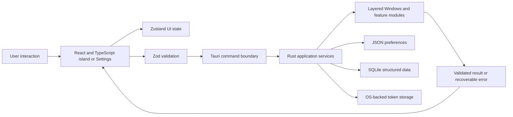

## Appendix B. Core interaction flow

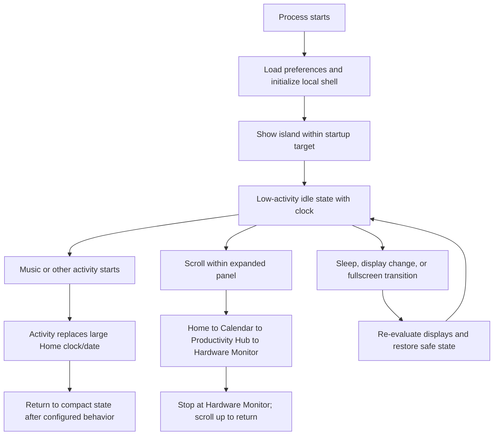

## Appendix C. Supplied UI references

### Idle clock and date

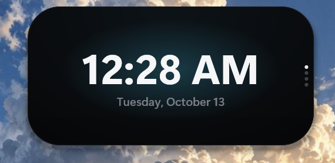

### Compact time and weather

### Concurrent timer and media

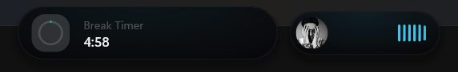

### Hardware monitor

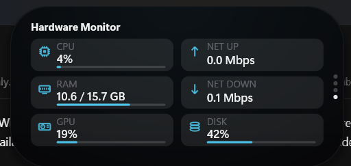

### Island context menu

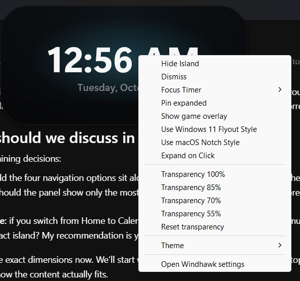

### Calendar

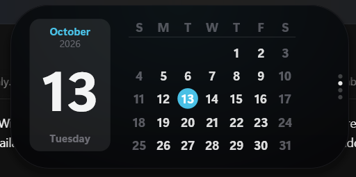

### Notification

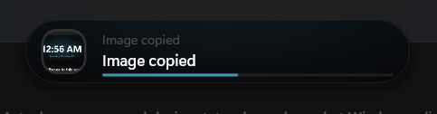

### Microphone privacy status

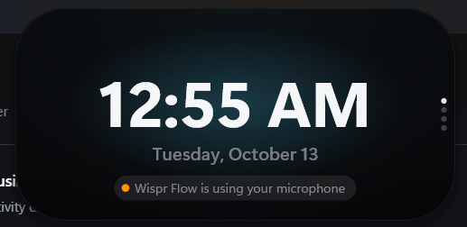

### File shelf inspiration

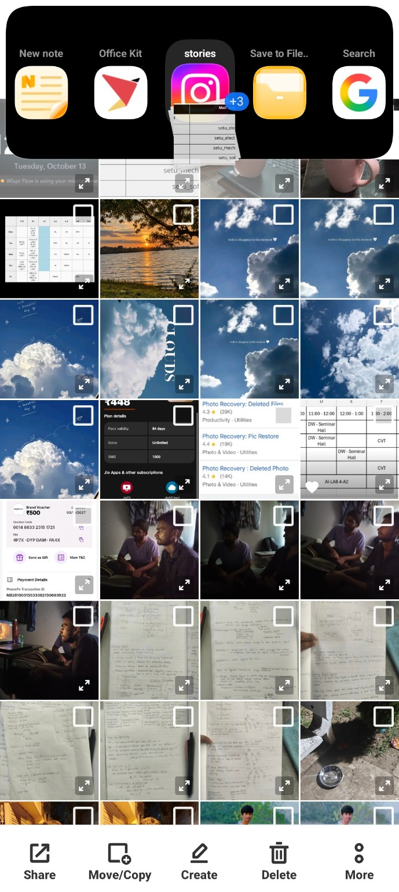
