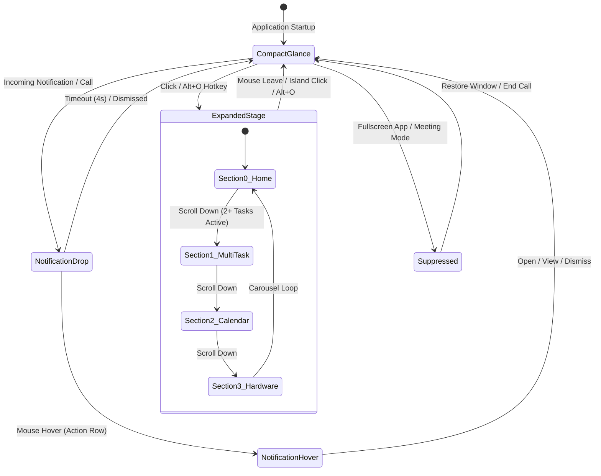

# ORBIT Island

<div align="center">

**A fluid, hardware-accelerated 3D Dynamic Island desktop companion engineered natively for Windows 11.**

[](https://github.com/Dineswarkumar/Orbit-Island)
[](https://tauri.app/)
[](https://www.rust-lang.org/)
[](https://react.dev/)
[](#)
[](LICENSE)

</div>

---

ORBIT Island brings Apple's glanceable, tactile Dynamic Island UX to Windows 11. Floating discreetly at the top of your display, ORBIT blends hardware telemetry, system media controls, frequency-reactive equalizer bars, notification drops, focus countdowns, academic schedule calendars, a drag-and-drop file shelf, and real-time camera/microphone privacy indicators into an organic, glass-rendered desktop overlay.

---

## Download & Setup

Download the official standalone Windows installer from the [Releases page](https://github.com/Dineswarkumar/Orbit-Island/releases):

- **Installer**: [`ORBIT_2.0.0_x64-setup.exe`](https://github.com/Dineswarkumar/Orbit-Island/releases/download/v2.0.0/ORBIT_2.0.0_x64-setup.exe) (~3.1 MB)
- **Architecture**: Windows 11 x64 (Native binary with embedded WebView2 runtime)
- **Installation**: Run `ORBIT_2.0.0_x64-setup.exe` and follow the setup wizard. ORBIT launches automatically at the top of your primary display.

---

## System Architecture & Dynamic Flows

ORBIT is built upon a hybrid architecture: a low-latency Rust backend communicating with a React 18 / Tailwind CSS frontend via Tauri v2 IPC.

### 1. Shell Morphology & State Machine



### 2. Privacy Guard Telemetry Engine

ORBIT employs a zero-hardware-locking, dual-engine privacy monitor to instantly detect active recording or streaming:

```mermaid
flowchart TD
    subgraph Windows 11 Hardware & Drivers
        CamDriver["Webcam / Sensor Hardware"]
        MicDriver["Microphone Endpoint (eCapture)"]
    end

    subgraph Rust Core Privacy Monitor (lib.rs)
        MFMonitor["Media Foundation IMFSensorActivityMonitor"]
        WASAPIMonitor["WASAPI IAudioSessionManager2 Enumerator"]
        RegStore["CapabilityAccessManager ConsentStore"]
        PidCheck["is_pid_alive Process Survival Verifier"]
    end

    subgraph Frontend Reactive Stage (IslandApp.tsx)
        IPCEvent["privacy-state-changed (350ms Polling / Event Callbacks)"]
        CompactSlot["Compact Capsule Privacy Dot (Green / Yellow / Cyan)"]
        ExpandedSlot["Live Call Deck & Top-Right Safety Pill"]
    end

    CamDriver -->|Streaming Callback| MFMonitor
    MicDriver -->|Active Audio Session| WASAPIMonitor
    CamDriver -.->|Registry Fallback| RegStore
    MicDriver -.->|Registry Fallback| RegStore

    MFMonitor --> PidCheck
    WASAPIMonitor --> PidCheck
    RegStore --> PidCheck

    PidCheck --> IPCEvent
    IPCEvent --> CompactSlot
    IPCEvent --> ExpandedSlot
```

- **Microphone (WASAPI Core Audio API)**: Directly queries `IAudioSessionEnumerator` on all active capture devices (`eCapture`). Detects recording streams in real-time across Chrome, Discord, Zoom, Teams, and WhatsApp without registry latency.
- **Camera (Windows Media Foundation)**: Listens for `IMFSensorActivitiesReportCallback` streaming transitions. Eliminates artificial polling timeouts and verifies process survival with `is_pid_alive` so indicators remain active for the full call duration and self-heal if an application crashes.

---

## Core Feature Overview

### 1. Curated 11-Theme Signature Engine
Designed with OKLCH-balanced surfaces, dynamic 3D borders, and custom ambient shadows:

| Theme ID | Name | Accent | Characteristic |
| :--- | :--- | :---: | :--- |
| `obsidian` | **Apple Dynamic Island** | `#38bdf8` | Pure `#000000` OLED deep-black surface with subtle concentric border glow |
| `linear` | **Linear Studio** | `#6366f1` | Raycast-inspired dark indigo `#0b0d16` with crisp violet outlines |
| `dynamic` | **VisionOS Spatial Glass** | `#38bdf8` | Slate titanium `#0f172a` translucency with frosted glass depth |
| `catppuccin` | **Catppuccin Mocha** | `#cba6f7` | Soothing `#181825` lavender-and-mauve aesthetic with soft card fills |
| `cyber` | **Cyberpunk Neo-Tokyo** | `#06b6d4` | High-voltage neon cyan and magenta accents on `#030306` night pitch |
| `espresso` | **Sunset Velvet & Amber**| `#fb923c` | Deep burgundy velvet `#12070c` with radiant amber accents |
| `evergreen` | **Nordic Emerald** | `#34d399` | Scandinavian botanical `#06120e` with organic mint highlights |
| `nord` | **Arc Ocean & Gold** | `#38bdf8` | Deep marine blue `#0a1220` with solar gold secondary badges |
| `light` | **Apple Ceramic Alabaster**| `#2563eb` | High-contrast `#f1f5f9` pearlescent light mode with dark typography |
| `system` | **System Auto** | Auto | Follows native Windows 11 Dark/Light mode preference automatically |

---

### 2. Dynamic Section 2: Live Multi-Task Bento Hub
When 2 or more background activities occur simultaneously, ORBIT dynamically spawns a 4th navigation dot on the indicator rail, presenting a 2x2 Bento Hub:
- **Slot 1 (Media Controller)**: Real-time track title, artist, live play/pause, and next-track skip.
- **Slot 2 (Live Call & Privacy)**: Displays active app name (`Zoom`, `Google Chrome`, `WhatsApp`), call duration timer, and attribution. Clicking focuses the active call window.
- **Slot 3 (Focus Timer)**: Shows live countdown progress, quick 15m/25m/45m presets, and inline pause/stop controls.
- **Slot 4 (Today's Schedule)**: Highlights today's next academic exam, fest, deadline, or meeting.
- **Header**: Quick access button to open the File Shelf (`📁 Shelf (N)`).

---

### 3. Smart 3D Calendar & Academic Schedule Hub
A full monthly calendar overview powered by an embedded SQLite database:
- **Full-Cell Category Color Highlights**:
  - 🌹 **Exams**: Rose Red (`#fb7185`)
  - 🍊 **Deadlines & Due Dates**: Vibrant Orange (`#f97316`)
  - 🌿 **Holidays**: Emerald Green (`#34d399`)
  - ☀️ **Fests & Events**: Amber Gold (`#fbbf24`)
  - 💎 **Classes**: Sky Blue (`#38bdf8`)
  - 🟣 **Meetings**: Violet Purple (`#a855f7`)
- **Universal Schedule Importer**: 1-click import support for RFC 5545 iCalendar (`.ics`), `.csv` (`Title, Date, Time, Category`), and `.json` university or workplace timetables. Automatically prevents duplicates and maps colors across the calendar grid.
- **15-Minute Event Alerts**: Dispatches glanceable 3D pill notifications 15 minutes before scheduled exams and meetings.

---

### 4. Frequency-Reactive Waveform Equalizer
- Direct integration with Windows System Media Transport Controls (SMTC) to display track titles, artists, and album artwork from Spotify, Chrome, Brave, Edge, and YouTube Music.
- Real-time WASAPI audio spectrum analysis driving 3-bar compact and 5-bar expanded frequency equalizers that react to audio peaks and collapse flat when silent.

---

### 5. Hardware Telemetry & One-Click RAM Boost
- **CPU**: Real-time multi-core processor utilization.
- **GPU**: Direct Windows Performance Data Helper (PDH) GPU engine load tracking.
- **RAM**: Memory usage percentage with physical GB tracking and a one-click **Free RAM** cleaner calling Win32 `EmptyWorkingSet`.
- **Storage & Network**: Disk space monitoring and real-time up/down bandwidth speed indicators.
- **Battery**: Dynamic fill gauge with charging state animations and color-coded thresholds.

---

### 6. File Shelf & Desktop Productivity
- Drag-and-drop storage drawer in Expanded Home for holding files during multi-task workflows.
- One-click file opening or revealing in File Explorer.
- Configurable storage mode: Reference links or managed temporary copies (`shelfStorageMode: "copy"`).

---

### 7. Global Keyboard Shortcuts & Stealth Capture
- **`Alt+O`**: Expand / Collapse Island.
- **`Alt+H`**: Hide / Show Island.
- **`Alt+S`**: Toggle Screen-Recording Stealth (uses Win32 `SetWindowDisplayAffinity(WDA_EXCLUDEFROMCAPTURE)` to make ORBIT completely invisible to OBS, Discord, Zoom, and Teams screen sharing).
- **`Alt+M`**: Play / Pause current media track.

---

## Design References & Inspirations

ORBIT Island is deeply indebted to pioneering work in glanceable interaction design and fluid desktop software:

1. **Apple Dynamic Island (iPhone 14 Pro / 15 / 16)**:
   - The foundational concept of an organic, concentric, glanceable pill that morphs to accommodate notifications, ongoing background tasks, and controls without interrupting user flow.
2. **Apple Human Interface Guidelines (HIG) & Spring Physics**:
   - Synthesizes design standards from the community's leading Apple UI engineering skillsets:
     - **Emil Kowalski** ([`emilkowalski/skills`](https://github.com/emilkowalski)): Fluid layout transitions, spring physics (`cubic-bezier(0.22, 1.15, 0.36, 1)`), micro-interactions, and motion timing.
     - **Dick Wu** ([`dickwu/apple-design-skill`](https://github.com/dickwu)): Concentric corner radii, subtle depth layers, and typographic hierarchy.
     - **Wondelai** ([`wondelai/skills`](https://github.com/wondelai)): iOS HIG design rules adapted for desktop Tauri + React + Tailwind architectures.
3. **Linear & Raycast Studio**:
   - High-density dark mode design, tactile command responsiveness, monospace tabular numerals, and glowing border highlights (`0 0 12px var(--island-border)`).
4. **Windows 11 Fluent Design & Core Audio APIs**:
   - Deep integration with native Win32 GDI non-rectangular regions, Windows Media Foundation Sensor Monitor, and WASAPI audio session endpoints.

---

## Build from Source

### Prerequisites

- [Node.js](https://nodejs.org/) (v18 or higher)
- [Rust](https://www.rust-lang.org/) (v1.90 or higher, 2024 edition)
- Windows 11 with C++ Build Tools installed

### Instructions

1. **Clone the repository**:
   ```bash
   git clone https://github.com/Dineswarkumar/Orbit-Island.git
   cd Orbit-Island
   ```

2. **Install frontend dependencies**:
   ```bash
   npm install
   ```

3. **Run in development mode**:
   ```bash
   npm run tauri dev
   ```

4. **Run unit and stress test suite**:
   ```bash
   cargo test --manifest-path src-tauri/Cargo.toml
   ```

5. **Build standalone release installer**:
   ```bash
   npm run tauri build
   ```
   The installer will be generated at:
   `src-tauri/target/release/bundle/nsis/ORBIT_2.0.0_x64-setup.exe`

---

## License

This project is licensed under the [MIT License](LICENSE).
