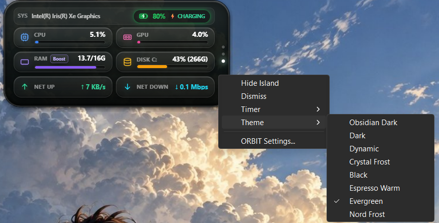
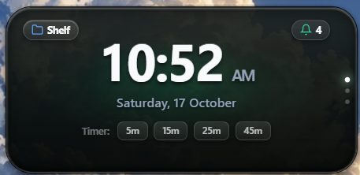
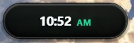
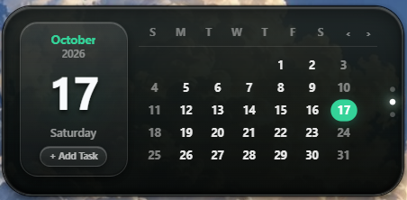

# ORBIT Island

<div align="center">

**A sleek, 3D Dynamic Island desktop overlay engineered natively for Windows 11.**

[](https://github.com/Dineswarkumar/Orbit-Island)
[](https://tauri.app/)
[](https://www.rust-lang.org/)
[](https://react.dev/)
[](#)
[](LICENSE)

</div>

---

ORBIT Island brings a fluid, glanceable desktop companion to Windows 11. Floating unobtrusively at the top of your display, ORBIT combines live system telemetry, native media controls, notification previews, focus timers, calendar reminders, and a drag-and-drop file shelf into a responsive, hardware-accelerated 3D overlay.

---

## Screenshots

<div align="center">

### Real-Time Hardware Telemetry Grid & Native Context Menu

*Telemetry panel displaying live CPU utilization, GPU usage via Windows PDH, RAM with one-click Boost memory cleaner, Disk C storage, Net Up/Down bandwidth, and native right-click theme & action menu.*

---

### Expanded Clock & Quick Timers

*Expanded home view featuring real-time clock, quick timer presets, drag-and-drop file shelf shortcut, and notification indicator.*

---

### Compact Glance Capsule

*Minimalist, unobtrusive desktop pill displaying glanceable time with fluid hover-expansion dynamics.*

---

### Calendar & Productivity Hub

*Monthly calendar overview with active day highlight, date card, and local SQLite-backed task management.*

</div>

---

## Features

- **3D Animated Shell**: Smooth transitions between compact glance capsule, dropped notification toast, and expanded multi-section hub powered by spring physics.
- **Glanceable Live Clock**: Real-time time and date display in both compact mode and idle expanded state.
- **Windows Media Controls (SMTC)**: Native integration with Windows System Media Transport Controls. Play, pause, skip, seek, and view album art and track metadata across Spotify, Brave, Chrome, Apple Music, and more with source pinning.
- **Windows Notification Capture**: Non-intrusive notification drop banner with brand icon recognition (WhatsApp, Telegram, Snipping Tool, etc.), sender/body separation, queue browsing, and an optional Privacy Mode to hide message content.
- **System Privacy Indicators**: Real-time visual status pills whenever the microphone or camera is active, complete with attribution to the active application.
- **Hardware Telemetry Monitor**:
  - Live CPU utilization.
  - Dedicated GPU utilization tracked via native Windows Performance Data Helper (PDH).
  - RAM monitoring with a one-click **Boost** memory cleaner.
  - Disk storage utilization.
  - Real-time Network upload and download bandwidth rates.
  - Battery capacity percentage with dynamic charging state color indicators.
- **Peripheral & Connectivity Pill Alerts**: Instant 2-second pill notifications for power connection/disconnection, Wi-Fi state changes, Bluetooth connections, and mobile hotspot toggles.
- **Focus & Countdown Timer**: Quick-start timers (5m, 15m, 25m Focus) featuring a circular countdown progress ring in the compact capsule and audio/visual completion alerts.
- **Calendar & Reminders**: Visual month calendar with selected date overview and local reminders stored in an embedded SQLite database.
- **File Shelf**: Drag-and-drop storage drawer in Expanded Home for holding temporary file references and opening or revealing files instantly in File Explorer.
- **8 Polished Themes**:
  - Obsidian Studio
  - Linear Indigo
  - Titanium Slate
  - OLED Black
  - Warm Bronze
  - Sage Emerald
  - Arctic Frost
  - Crystal Frost
- **Materials & Translucency**: Selectable glass materials including Frosted Glass, Glossy Glass, Smoked Glass, and Solid styling.
- **Desktop Overlay Intelligence**: Always-on-top window layering with smart fullscreen auto-hide that automatically suspends display during fullscreen games or media playback.
- **System Tray & Single-Instance**: Lightweight background presence with single-instance process lock, Windows startup launch option, tray menu actions, and rotating local diagnostic logs.

---

## Installation

Download the official standalone Windows installer from the [Releases page](https://github.com/Dineswarkumar/Orbit-Island/releases):

1. Download **`ORBIT_1.0.0_x64-setup.exe`**.
2. Run the installer and follow the setup wizard.
3. ORBIT Island will launch at the top-center of your primary display.

---

## Build from Source

### Prerequisites

Ensure the following tools are installed on your Windows 11 machine:

- **Node.js**: `v20.x` or higher
- **Rust**: `1.90.0` or higher (`rustup default stable`)
- **Visual Studio Build Tools**: C++ x64 build tools (MSVC toolchain)
- **Microsoft Edge WebView2**: (Pre-installed by default on Windows 11)

### Setup & Development

```powershell
# Clone the repository
git clone https://github.com/Dineswarkumar/Orbit-Island.git
cd Orbit-Island

# Install frontend dependencies
npm install

# Start development mode (launches Vite dev server and Tauri shell)
npm run tauri dev
```

### Build Production Installer

```powershell
# Build the optimized production release
npm run tauri build
```

The resulting standalone NSIS installer will be located at:
```text
src-tauri/target/release/bundle/nsis/ORBIT_1.0.0_x64-setup.exe
```

---

## Usage

- **Hover to Expand**: Move your cursor over the compact capsule to expand the full multi-section island.
- **Scroll Navigation**: Use the mouse scroll wheel or touchpad scroll over the expanded island to cycle through sections:
  $$\text{Home} \longrightarrow \text{Calendar} \longrightarrow \text{Productivity Hub} \longrightarrow \text{Hardware Monitor}$$
- **Right-Click Menu**: Right-click on the island at any time to access quick actions:
  - Hide or Dismiss Island
  - Start quick timers (5m, 15m, 25m Focus, or Cancel)
  - Change active Theme on the fly
  - Open ORBIT Settings
- **System Tray**: Access the ORBIT tray icon in your Windows notification area to toggle visibility, open settings, or exit the application cleanly.

---

## Settings

ORBIT Island includes a dedicated Settings panel allowing you to configure:

- **Appearance**: Switch themes, choose glass material styles (Frosted, Glossy, Smoked, Solid), and adjust opacity.
- **Positioning**: Align the island to Top-Center, Top-Left, or Top-Right with custom vertical offsets.
- **Notifications & Privacy**: Enable Privacy Mode to redact sensitive notification text, and manage app attribution settings.
- **Startup & Performance**: Toggle automatic launch on Windows startup and tune background hardware polling intervals.

---

## Project Structure

```text
Orbit-Island/
├── src/                          # React + TypeScript frontend
│   ├── assets/                   # Icons, sounds, and media assets
│   ├── components/               # UI components
│   │   ├── island/               # Island sections (Home, Calendar, Hardware, Capsule, Shelf)
│   │   └── settings/             # Settings modal and configuration panels
│   ├── core/                     # State stores, IPC client, and theme engines
│   └── styles/                   # Tailwind CSS styling and theme definitions
├── src-tauri/                    # Rust backend (Tauri 2)
│   ├── src/
│   │   ├── commands/             # IPC handlers (hardware, media, shelf, calendar, window)
│   │   ├── services/             # Windows integrations (SMTC, PDH, notifications, SQLite, Win32)
│   │   ├── lib.rs                # App setup, tray, and context menus
│   │   └── main.rs               # Binary entry point
│   ├── Cargo.toml                # Rust dependencies and custom build profiles
│   └── tauri.conf.json           # Tauri window, permission, and bundle configuration
├── docs/
│   └── screenshots/              # Product screenshots and visual documentation
├── .planning/                    # Project roadmap, state tracking, and architecture plans
├── ORBIT-PRD.md                  # Comprehensive product requirements document
└── LICENSE                       # MIT License
```

---

## Performance

ORBIT Island is built with a native Rust core and high-performance Web technology:

- **Memory Usage**: ~55 MB RAM during active usage.
- **CPU Footprint**: <1% idle CPU utilization on modern Windows systems.
- **Optimized Rendering**: Background polling and animations automatically idle when the island is collapsed.

---

## Roadmap

To view the upcoming feature milestones, architectural specifications, and release tracking, refer to [.planning/ROADMAP.md](.planning/ROADMAP.md).

---

## Privacy

ORBIT Island is 100% local-first:

- **Zero Telemetry**: No tracking, user analytics, or background telemetry.
- **Zero Cloud Dependencies**: Operates completely offline without external servers.
- **Local Storage**: All settings, calendar reminders, file references, and local logs reside exclusively on your machine at:
  ```text
  %APPDATA%\com.orbit.island
  ```

---

## License

This project is licensed under the MIT License — see the [LICENSE](LICENSE) file for details.

Copyright (c) 2026 Dineswarkumar.
