# ORBIT Island

<div align="center">

**A fluid, hardware-accelerated 3D Dynamic Island desktop companion engineered natively for Windows 11.**

[](https://github.com/Dineswarkumar/Orbit-Island)
[](https://tauri.app/)
[](https://www.rust-lang.org/)
[](https://react.dev/)
[](#)
[](LICENSE)

</div>

---

ORBIT Island brings Apple's glanceable, tactile Dynamic Island UX to Windows 11. Floating discreetly at the top of your display, ORBIT blends hardware telemetry, system media controls, frequency-reactive equalizer bars, notification drops, focus countdowns, academic schedule calendars, a theme-matched drag-to-expand file tray, and real-time camera/microphone privacy indicators into an organic, glass-rendered desktop overlay.

---

## Download & Setup

Windows installers and standalone builds are published on the [GitHub Releases page](https://github.com/Dineswarkumar/Orbit-Island/releases). Compiled binaries, local build outputs, and installer staging files are kept out of this source repository.

---

## Latest UI · Version 3.2.0 Liquid Glass

The screenshots below show ORBIT's light and dark Liquid Glass themes, notification surfaces, and expanded calendar.

| Liquid Glass home · light | Notification · expanded |
| :---: | :---: |
| 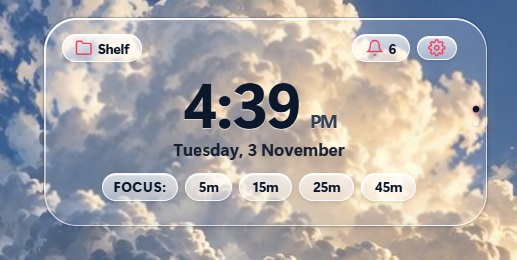 | 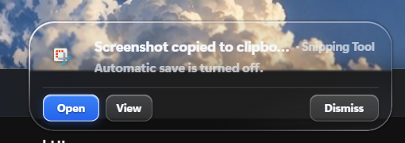 |

| Notification · compact | Calendar |
| :---: | :---: |
| 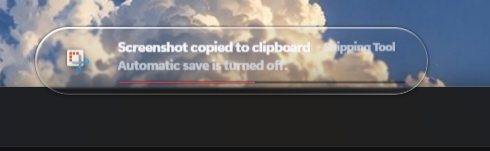 | 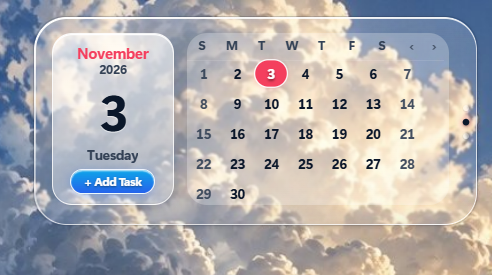 |

| Liquid Glass home · dark |
| :---: |
| 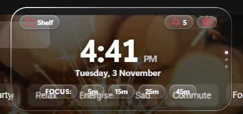 |

### Drag-to-expand file tray

Dragging files onto ORBIT opens a horizontal target tray that follows the selected glass or opaque theme. Targets include Shelf, Windows Share, Open, Open with, File Explorer, Print, and up to six pinned web destinations. Windows Share passes the selected files to Windows, which lists compatible installed share targets such as Outlook/Mail, WhatsApp, Teams, Nearby Sharing, and OneNote when available for that Windows version, account, app installation, and file type. ORBIT cannot force an app to appear or control the app's recipient/compose screen; Windows and the destination app handle that next step. A pinned web destination saves the files to Shelf, opens the site, and reveals the saved file for manual upload; websites do not receive automatic file attachments. Saved Shelf files can also be sent to Windows Open with or opened beside a pinned site. Shelf can keep a path reference without copying file data, or make a managed copy limited by available storage. Text and links can be saved to Shelf with a per-item keep-after-restart option. ORBIT does not monitor the clipboard in the background. Drag-to-expand can be switched off in Settings.

### Version 3.2.5 updates
- Calendar month headings and date cells now share the same seven-column width, keeping every weekday aligned across the full month grid.
- Adding a task now blocks duplicate submits, keeps the event inside the calendar form, and shows an inline error if saving fails.


- Context-menu actions now report failures to the app log instead of silently ignoring failed menu events.
- Hiding the island forces the tray icon visible as a restore path, even if the user's normal tray preference is off; showing the island restores that preference.
- Auto-hide in fullscreen and keyboard/tray restore paths now keep tray visibility in sync with whether the island is visible.

### Version 3.2.4 updates

- Fixed Windows Share crash (`0xc0000005` in `twinapi.appcore.dll`) by ensuring COM apartment stability and main UI thread dispatch with deferral handling.
- Fixed drag-and-drop region collapse, DPI coordinate tracking on multi-DPI displays, and file shelf action double-activation debouncing.
- Fixed rapid duplicate app activation and browser tab switching across UIA patterns.
- Hardened background telemetry loops, notifications listener, and SQLite/media mutexes against panics.

### Version 3.2.3 updates

- Notification logos now use the sender app identity only, so a ChatGPT message mentioning WhatsApp cannot display WhatsApp's logo.
- Ordinary notification text no longer triggers the urgent Alert badge by containing words such as “alert”; priority badges are limited to timer, alarm, and reminder notifications from matching utility apps.
- Notifications with the same display name but different app identities stay in separate groups.

### Version 3.2.2 updates

- Added a Windows Share target that sends dropped files through the native Windows share panel for compatible installed apps.
- Replaced stale share callbacks on repeated attempts and guarded event cleanup so rapid shares cannot accumulate old file payloads.
- Kept the existing Shelf, open, print, settings, media, and timer paths separate from the share action.

### Version 3.2.1 updates

- Shelf drops now resolve the latest pinned website settings, so destinations added after launch do not fall through as unsupported targets.
- Shelf file picking and clearing are guarded against rapid repeated clicks; changing/removing Shelf contents waits until a picker add finishes.
- Window and drag-over events are no longer synchronously written to disk on every pointer movement.
- Startup skips synchronous hardware status queries; the hardware monitor supplies live values after launch.
- Settings section navigation uses compact labeled icons, and the wide layout uses two columns to reduce unused space.
- Compact dual media and timer mode uses a larger timer readout.

### Version 3.2.0 updates

- Settings now use a responsive three-column layout on wide screens, with section shortcuts, a persistent Terms & Privacy page, and links to the project and release notes.
- Repeated launches focus the existing ORBIT window instead of starting another instance or terminating existing processes.
- Memory reporting separates ORBIT from its verified WebView2 child processes and removes the arbitrary RAM budget label.
- Smart Auto uses weather only when online weather is enabled; otherwise it shows the ORBIT mark. Custom text remains an explicit choice.
- Shelf supports deliberately saved text and URLs, with an option to keep each item after restarting Windows.
- Online weather is optional; when enabled, ORBIT requests weather from wttr.in. The app does not upload settings or Shelf contents.

---

## Earlier UI · Version 2.1.2

<div align="center">

### 3D Hardware Telemetry & Typography Settings (v2.1.2)
| Real-Time Hardware Telemetry (Balanced Arrows & Radiant Battery) | 3D Settings Engine & Typography Presets |
| :---: | :---: |
| 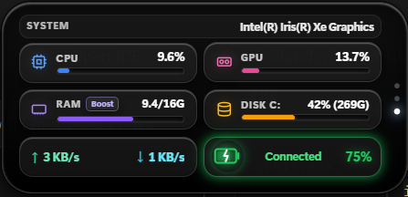 | 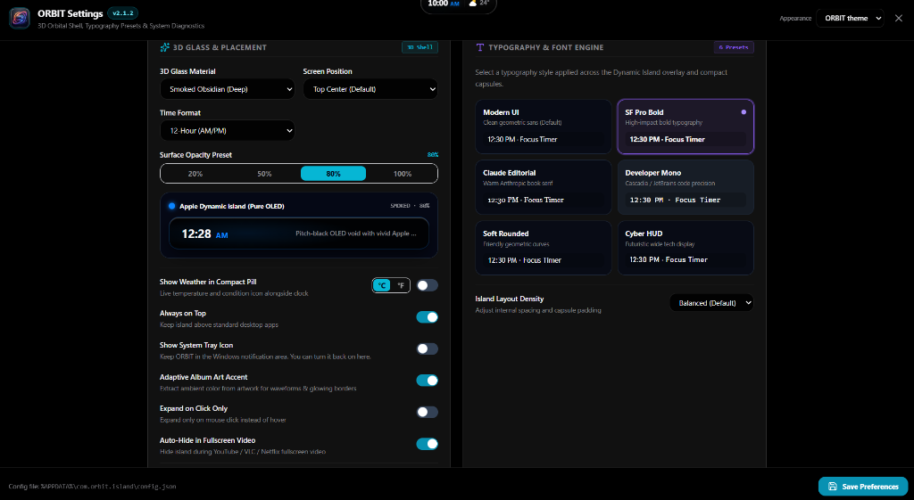 |

### Expanded Experience & Media Island
| Home Stage (Expanded Clock & Controls) | Audio Stream & Frequency Equalizer |
| :---: | :---: |
| 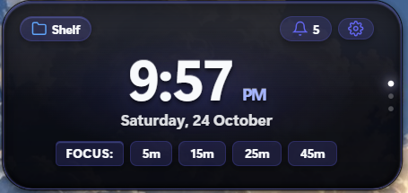 | 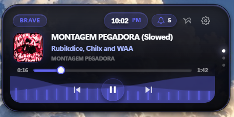 |

### Compact Multi-Tasking & Dynamic Drops
| Dual-Tasking Compact Capsule | 3D Notification Drop |
| :---: | :---: |
| 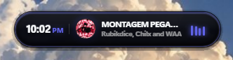 | 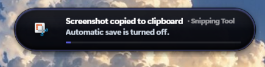 |

### Academic & Schedule Hub
| Full-Month Interactive Academic Calendar & Event Color Highlights |
| :---: |
| 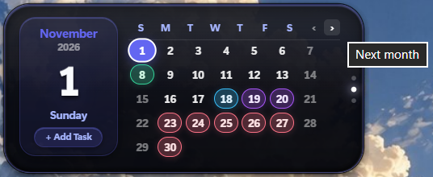 |

</div>

---

## System Architecture & Dynamic Flows

ORBIT is built upon a hybrid architecture: a low-latency Rust backend communicating with a React 18 / Tailwind CSS frontend via Tauri v2 IPC.

### 1. Shell Morphology & State Machine

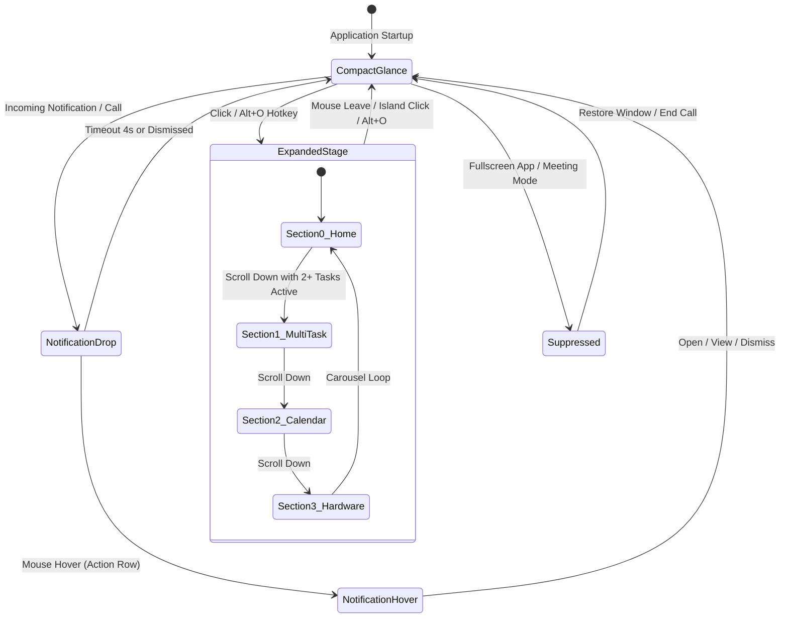

### 2. Privacy Guard Telemetry Engine

ORBIT employs a zero-hardware-locking, dual-engine privacy monitor to instantly detect active recording or streaming:

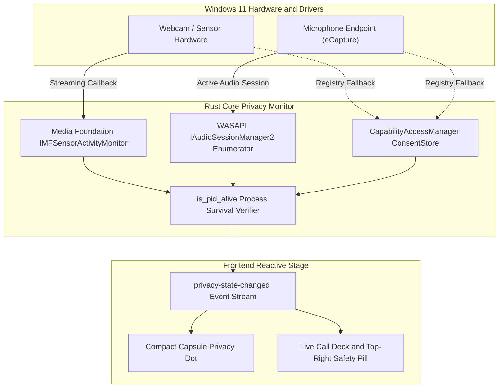

- **Microphone (WASAPI Core Audio API)**: Directly queries `IAudioSessionEnumerator` on all active capture devices (`eCapture`). Detects recording streams in real-time across Chrome, Discord, Zoom, Teams, and WhatsApp without registry latency.
- **Camera (Windows Media Foundation)**: Listens for `IMFSensorActivitiesReportCallback` streaming transitions. Eliminates artificial polling timeouts and verifies process survival with `is_pid_alive` so indicators remain active for the full call duration and self-heal if an application crashes.

---

## Core Feature Overview

### 1. Curated 11-Theme Signature Engine
Designed with OKLCH-balanced surfaces, dynamic 3D borders, and custom ambient shadows:

| Theme ID | Name | Accent | Characteristic |
| :--- | :--- | :---: | :--- |
| `obsidian` | **Apple Dynamic Island** | `#38bdf8` | Pure `#000000` OLED deep-black surface with subtle concentric border glow |
| `linear` | **Linear Studio** | `#6366f1` | Raycast-inspired dark indigo `#0b0d16` with crisp violet outlines |
| `dynamic` | **VisionOS Spatial Glass** | `#38bdf8` | Slate titanium `#0f172a` translucency with frosted glass depth |
| `catppuccin` | **Catppuccin Mocha** | `#cba6f7` | Soothing `#181825` lavender-and-mauve aesthetic with soft card fills |
| `cyber` | **Cyberpunk Neo-Tokyo** | `#06b6d4` | High-voltage neon cyan and magenta accents on `#030306` night pitch |
| `espresso` | **Sunset Velvet & Amber**| `#fb923c` | Deep burgundy velvet `#12070c` with radiant amber accents |
| `evergreen` | **Nordic Emerald** | `#34d399` | Scandinavian botanical `#06120e` with organic mint highlights |
| `nord` | **Arc Ocean & Gold** | `#38bdf8` | Deep marine blue `#0a1220` with solar gold secondary badges |
| `light` | **Apple Ceramic Alabaster**| `#2563eb` | High-contrast `#f1f5f9` pearlescent light mode with dark typography |
| `system` | **System Auto** | Auto | Follows native Windows 11 Dark/Light mode preference automatically |

---

### 2. Dynamic Section 2: Live Multi-Task Bento Hub
When 2 or more background activities occur simultaneously, ORBIT dynamically spawns a 4th navigation dot on the indicator rail, presenting a 2x2 Bento Hub:
- **Slot 1 (Media Controller)**: Real-time track title, artist, live play/pause, and next-track skip.
- **Slot 2 (Live Call & Privacy)**: Displays active app name (`Zoom`, `Google Chrome`, `WhatsApp`), call duration timer, and attribution. Clicking focuses the active call window.
- **Slot 3 (Focus Timer)**: Shows live countdown progress, quick 15m/25m/45m presets, and inline pause/stop controls.
- **Slot 4 (Today's Schedule)**: Highlights today's next academic exam, fest, deadline, or meeting.
- **Header**: Quick access button to open the File Shelf (`📁 Shelf (N)`).

---

### 3. Smart 3D Calendar & Academic Schedule Hub
A full monthly calendar overview powered by an embedded SQLite database:
- **Full-Cell Category Color Highlights**:
  - 🌹 **Exams**: Rose Red (`#fb7185`)
  - 🍊 **Deadlines & Due Dates**: Vibrant Orange (`#f97316`)
  - 🌿 **Holidays**: Emerald Green (`#34d399`)
  - ☀️ **Fests & Events**: Amber Gold (`#fbbf24`)
  - 💎 **Classes**: Sky Blue (`#38bdf8`)
  - 🟣 **Meetings**: Violet Purple (`#a855f7`)
- **Universal Schedule Importer**: 1-click import support for RFC 5545 iCalendar (`.ics`), `.csv` (`Title, Date, Time, Category`), and `.json` university or workplace timetables. Automatically prevents duplicates and maps colors across the calendar grid.
- **15-Minute Event Alerts**: Dispatches glanceable 3D pill notifications 15 minutes before scheduled exams and meetings.

---

### 4. Frequency-Reactive Waveform Equalizer
- Direct integration with Windows System Media Transport Controls (SMTC) to display track titles, artists, and album artwork from Spotify, Chrome, Brave, Edge, and YouTube Music.
- Real-time WASAPI loopback FFT spectrum: 20 log-spaced bands from 40 Hz–16 kHz, mapped to four compact bars and 20 expanded bars, with meter fallback when loopback capture is unavailable.

---

### 5. Hardware Telemetry & One-Click RAM Boost
- **CPU**: Real-time multi-core processor utilization.
- **GPU**: Direct Windows Performance Data Helper (PDH) GPU engine load tracking.
- **RAM**: System memory usage with physical GB tracking, plus a one-click boost that asks Windows to trim working sets for apps in the current sign-in session. ORBIT reports the observed change in available system RAM and how many app processes were trimmed. Windows can make those pages available to other apps; applications may use them again as they run.
- **Storage**: C: drive capacity and usage percentage with remaining free gigabytes.
- **Horizontal Network Cards**: Real-time bandwidth throughput distributed horizontally with dedicated emerald upload arrow (`↑`) on the left and cyan download arrow (`↓`) on the right.
- **Radiant 3-Column Battery Pill**:
  - **Left**: Battery SVG shell with dynamic level fill and an illuminated lightning splash bolt (`⚡`) with pulsing green radial glow when connected to power.
  - **Middle**: Status statement (`Connected`, `Charging`, or `Discharging`).
  - **Right**: Right-aligned bold tabular percentage (e.g. `75%` or `AC`).
  - **Color-Coded Thresholds**: $\ge 80\%$ Green (`#22c55e`), $30\% - 79\%$ Amber/Orange (`#f59e0b`), $< 30\%$ Alert Red (`#ef4444`).

---

### 6. File Shelf & Desktop Productivity
- Drag-and-drop storage drawer in Expanded Home for holding files during multi-task workflows.
- One-click file opening or revealing in File Explorer.
- Configurable storage mode: Reference links or managed temporary copies (`shelfStorageMode: "copy"`).

---

### 7. Global Keyboard Shortcuts & Stealth Capture
- **`Alt+O`**: Expand / Collapse Island.
- **`Alt+H`**: Hide / Show Island.
- **`Alt+S`**: Toggle Screen-Recording Stealth (uses Win32 `SetWindowDisplayAffinity(WDA_EXCLUDEFROMCAPTURE)` to make ORBIT completely invisible to OBS, Discord, Zoom, and Teams screen sharing).
- **`Alt+M`**: Play / Pause current media track.

---

## Design References & Inspirations

ORBIT Island is deeply indebted to pioneering work in glanceable interaction design and fluid desktop software:

1. **Apple Dynamic Island (iPhone 14 Pro / 15 / 16)**:
   - The foundational concept of an organic, concentric, glanceable pill that morphs to accommodate notifications, ongoing background tasks, and controls without interrupting user flow.
2. **Apple Human Interface Guidelines (HIG) & Spring Physics**:
   - Synthesizes design standards from the community's leading Apple UI engineering skillsets:
     - **Emil Kowalski** ([`emilkowalski/skills`](https://github.com/emilkowalski)): Fluid layout transitions, spring physics (`cubic-bezier(0.22, 1.15, 0.36, 1)`), micro-interactions, and motion timing.
     - **Dick Wu** ([`dickwu/apple-design-skill`](https://github.com/dickwu)): Concentric corner radii, subtle depth layers, and typographic hierarchy.
     - **Wondelai** ([`wondelai/skills`](https://github.com/wondelai)): iOS HIG design rules adapted for desktop Tauri + React + Tailwind architectures.
3. **Linear & Raycast Studio**:
   - High-density dark mode design, tactile command responsiveness, monospace tabular numerals, and glowing border highlights (`0 0 12px var(--island-border)`).
4. **Windhawk & Windows Customization Philosophy**:
   - Inspired by **Windhawk** ([`windhawk.net`](https://windhawk.net/) by Ramen Software), embracing modular, non-destructive Windows desktop customization that respects system performance, low memory footprint, and native Win32 window management hooks without intrusive system patching.
5. **Windows 11 Fluent Design & Core Audio APIs**:
   - Deep integration with native Win32 GDI non-rectangular regions, Windows Media Foundation Sensor Monitor, and WASAPI audio session endpoints.

---

## Build from Source

### Prerequisites

- [Node.js](https://nodejs.org/) (v18 or higher)
- [Rust](https://www.rust-lang.org/) (v1.90 or higher, 2024 edition)
- Windows 11 with C++ Build Tools installed

### Instructions

1. **Clone the repository**:
   ```bash
   git clone https://github.com/Dineswarkumar/Orbit-Island.git
   cd Orbit-Island
   ```

2. **Install frontend dependencies**:
   ```bash
   npm install
   ```

3. **Run in development mode**:
   ```bash
   npm run tauri dev
   ```

4. **Run unit and stress test suite**:
   ```bash
   cargo test --manifest-path src-tauri/Cargo.toml
   ```

5. **Build standalone release installer**:
   ```bash
   npm run tauri build
   ```
   The installer will be generated at:
   `src-tauri/target/release/bundle/nsis/ORBIT_3.2.0_x64-setup.exe`

---

## License

This project is licensed under the [MIT License](LICENSE).
